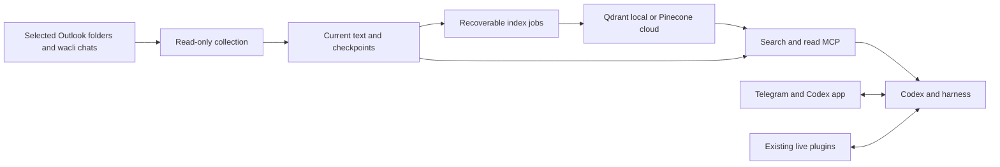

# Install and operate the consolidated second brain

Run this command from the checkout:

```bash
./secondbrain.sh setup
# Equivalent installer entry:
./install.sh setup
```

Inside Ubuntu 24.04, it prepares that host. On a Mac, it offers Azure provisioning and continues with the same setup inside the VM. The wizard installs Codex, activates a persistent harness checkout, reconciles every dependency in `skills.toml`, installs the applications, connects selected sources, configures retrieval and starts user services. Repeating it probes existing resources and resumes incomplete work. No arguments (`./secondbrain.sh`) also opens setup.

The first run needs an interactive terminal, internet access and sudo on the VM. The shell reuses Python 3.11–3.13. If no compatible interpreter is available, it installs Python through Ubuntu 24.04 apt or an existing macOS Homebrew. It preserves existing interpreters and shell profiles. A Mac without Homebrew needs that prerequisite or a compatible Python before setup. Device codes and QR codes stay in the terminal. Azure needs an operator subscription and permission to create infrastructure and state storage. A Microsoft Entra public-client application is required for Outlook. External accounts cannot be created or tenant consent granted by installing software.

Help and the complete plan work before Python is installed:

```bash
./install.sh setup --help
./install.sh setup --dry-run
```

The bootstrap follows the applicable structure of [OpenClaw's installer](https://docs.openclaw.ai/install/installer): platform checks, runtime reuse, terminal routing, explicit stages and verification before success. Provider and service reconciliation stay in the Python wizard. Package bootstrap failures return nonzero and explain how to retry. Phase results distinguish verified, incomplete and prerequisite-pending work. No hosted curl installer is published by this repository.

## Components and provenance

| Path | Responsibility |
| --- | --- |
| `install.sh`, `scripts/install*.py`, `skills/`, `integrations/` | Install Codex, activate the harness, and manage existing skills/plugins. |
| `scripts/codex-vm.sh`, `deployments/prod/tf/` | VM preparation/recovery, VPN-only administrative access, and persistent storage. |
| `backend/telegram/` | Authorized Telegram transport into the native harness. |
| `backend/whatsapp/` | Optional live Baileys bot; replies require explicit enablement. |
| `backend/context/` | Scoped Outlook/wacli ingestion, semantic/text search, and read-only MCP retrieval. |
| `context.template.toml` | Disabled-by-default source configuration. |

`component-imports.json` records source locations, import revisions, and selected-file snapshot digests. The WhatsApp checkout had no commit; its revision is null. Original source checkouts remain untouched. Credentials, instruction files, environments, and captured historical runs were excluded. Telegram retains its upstream MIT license and Ductor attribution. Its tests were adapted for component placement and the absence of standalone repository instruction/GitHub files.

## Storage and flow



SQLite owns current text, source identity, and checkpoints. Each complete source page commits with its checkpoint. The vector backend stores locally generated vectors and document identities, with no message text or credentials. Index failures retain pending jobs. Search validates each vector revision against its current document.

FastEmbed runs locally. First indexing downloads a public model; message text is not sent to a hosted embedding service. The default model supports multiple languages. `BAAI/bge-small-en-v1.5` is a lighter English alternative. Changing models rebuilds the derived collection on the next index run. A private lock serializes local Qdrant access; a competing operation returns a retryable busy error.

The existing `secondbrain.yaml` and `secondbrain-state/` still own reasoning, facts, agenda, and action receipts. The retrieval workspace is separate so it can erase copied payloads without changing the immutable event-history contract. No raw-payload migration runs automatically.

## The setup journey

Use Python 3.11–3.13. Ubuntu 24.04 includes a compatible Python. Setup installs missing Ubuntu prerequisites and a verified Node.js 24 release. It checks a Bubblewrap user namespace and loads Ubuntu's packaged AppArmor profile when needed. An existing administrator profile is preserved; global user-namespace restrictions are not disabled. Setup preserves existing `.venv` and `node_modules` directories and uses them when healthy.

```bash
./secondbrain.sh setup --plan
./secondbrain.sh setup
# Explicit entry modes:
./secondbrain.sh setup --mode host
./secondbrain.sh setup --mode azure
# Review saved choices:
./secondbrain.sh setup --reconfigure
```

The wizard offers Telegram, the optional Baileys reply bot and Remote Control. Qdrant is the default. It asks for one mailbox, selected folders, a starting date and explicit WhatsApp chat JIDs. It lists available chats after pairing. Existing `context.toml` is preserved; change its scopes explicitly using the erasure procedure below. A selected provider that is disabled or absent in that file remains incomplete rather than reporting an empty import as successful. Explicitly declining a provider during `--reconfigure` disables its retrieval without erasing retained data.

The private state defaults to `~/projects/.secondbrain`. It contains non-secret choices (`setup.json`), phase results (`setup-status.json`), per-MCP readiness (`mcp-readiness.json`), context configuration and account state. Files use owner-only permissions. Managed Codex packages and service helpers live under its `runtime/` directory; the user-local entry point links there. Migrating an existing tool directory retains its original backup. MCP tokens use `tool-secrets.json` and a private systemd environment file. Pinecone uses `pinecone.key`. Receipts and unit definitions contain no credential values. Use `./secondbrain.sh codex` to start Codex with the configured tool credentials. Gateways and boot services load those credentials directly from their private files.

Setup checks MCP initialization and tool discovery without invoking application tools. Missing required credentials, unavailable transports or failed services leave an incomplete result and return a nonzero exit code. Forwarded environment variables can be optional; setup also tries a transport without unset optional values. Runtime-managed plugins without portable MCP declarations remain explicitly identified in the readiness report. Desktop-dependent tools still need their desktop application or a reachable supported endpoint; plugin installation cannot supply that application on a headless VM. `--reconfigure` reviews credential values; an empty answer keeps a saved value. Changed tool environments refresh the managed services and Codex daemon.

Use `--config /path/choices.json --non-interactive` only after choices and credentials exist. `--no-prompt` is an alias. This mode isolates stdin and uses `sudo -n`, so missing privilege cannot open a password prompt. Missing choices stop before bootstrap installation. Missing authentication or unapproved cloud changes leave setup incomplete. `--dry-run` aliases `--plan` and never installs prerequisites. `--state /private/path` or `SECOND_BRAIN_STATE` selects another private state directory. Keep that directory outside the checkout. Advanced dependency-only development setup remains available:

```bash
./secondbrain.sh setup --component all
./secondbrain.sh doctor
```

The component interface installs dependencies without pairing, service activation or cloud provisioning. VS Code provides `secondbrain:setup` and `secondbrain:dependencies`. Its `fullstack` task runs local context collection using the ignored `context.toml`; prepare that configuration from the template before local development. Existing installer arguments and [recovery procedures](installation.md) remain available.

On macOS, Azure mode installs missing Azure CLI and Terraform through an existing Homebrew installation. It asks for the subscription, owner tag and Terraform state backend identity. Existing backend files define that identity and are preserved. New state storage requires explicit approval; its owner needs permission to assign Storage Blob Data Contributor. Setup shows the Terraform plan and requires another explicit approval before applying resource changes. It never silently migrates state or imports another deployment's resources.

Azure preparation mounts the managed workspace disk and reads SSH host trust through the VM agent. Initial VPN keys use ARM protected parameters, outside Terraform state and command arguments. A restored disk with another VPN CA is refused. Setup records the Azure VM identity and refreshes preparation after VM replacement. Starting a stopped VM requires explicit cost approval. Setup asks the operator to connect the generated OpenVPN profile, then uses strict host-key checking over the VPN. Public TCP/22 remains closed. The current local checkout is transferred as a Git bundle plus its reviewed source changes, so unpushed implementation is available on the VM. Ignored credentials, environments and arbitrary untracked notes are excluded. Independent changes in the remote checkout are preserved and reported.

Keep the VM checkout at `~/projects/dot-codex`. Setup creates private configuration beside it. For a manual configuration instead:

```bash
mkdir -p "$HOME/projects/.secondbrain"
chmod 700 "$HOME/projects/.secondbrain"
cp context.template.toml "$HOME/projects/.secondbrain/context.toml"
chmod 600 "$HOME/projects/.secondbrain/context.toml"
```

The template puts documents, vectors, models, and token caches on that disk. Local development can use an ignored `context.toml` and private local workspace. Add `--config /absolute/path/context.toml` to use another configuration.

## Optional Pinecone

Select `pinecone` in setup. Supply an API key, an index name and a dedicated namespace. The wizard checks the index against the actual local embedding dimension and cosine metric. An existing compatible index is reused. Creating an index requires an explicit cloud/region selection and cost approval. Setup never deletes or replaces an incompatible cloud index.

Pinecone receives vectors and identity metadata; embeddings and source text remain local. A workspace identity isolates points even if a namespace is accidentally shared. Source disable and revision checks still run against SQLite. Backend changes enqueue documents for projection; deletion jobs also target recorded previous projections. Keep old backend credentials until erasure completes. Changing a model in an existing cloud namespace requires a new namespace. Remote deletion acknowledgements are subject to Pinecone's consistency behavior; failed requests retain local deletion jobs.

See the [Pinecone Python SDK](https://github.com/pinecone-io/python-sdk) and [local development guidance](https://docs.pinecone.io/guides/production/mock-the-api). Pinecone Local reached end of life on October 7, 2026; Qdrant supplies the real local default. A stateless API mock does not establish retrieval quality or cloud persistence.

## Microsoft 365 mailbox

Use an approved Microsoft Entra public-client application with device-code flow enabled and delegated Graph `Mail.Read` and `User.Read` permissions. Tenant policy can require administrator consent. This application needs no client secret. See [public-client configuration](https://learn.microsoft.com/en-us/entra/identity-platform/scenario-desktop-app-configuration) and [device-code authentication](https://learn.microsoft.com/en-us/entra/msal/python/getting-started/acquiring-tokens).

Set the actual mailbox, application client ID, tenant, selected folder IDs or well-known names, and explicit `since` timestamp in its scope. Then enable the source. Inbox and Sent Items are examples; subfolders are not selected recursively.

```bash
./secondbrain.sh context doctor
./secondbrain.sh context login --source outlook
./secondbrain.sh context sync --source outlook --no-index
./secondbrain.sh context status
```

Complete browser sign-in using the displayed device code. The application verifies the selected mailbox before collection. The token cache stays under the workspace's private `auth/` directory. Collection only issues Graph GET requests; it does not mark mail read or send/move/delete mail.

Each folder keeps its own opaque continuation. Failed pages preserve checkpoints; earlier successful pages remain saved. Throttling leaves work for a later retry. Expired delta state requires a scoped rebuild. Microsoft limits date-filtered initial delta results to 5,000 messages. The adapter stops at that limit and reports incomplete coverage. Narrow the date/folders and rebuild. See [Graph message delta](https://learn.microsoft.com/en-us/graph/delta-query-messages).

## Selected WhatsApp chats

Setup installs the checksum-pinned wacli 0.25.0 release when a compatible user-local binary is absent. Its archive and checksums come from the [official release](https://github.com/openclaw/wacli/releases/tag/v0.25.0). Setup pairs it and supervises `sync --follow`. For manual operation:

```bash
wacli --store "$HOME/projects/.secondbrain/wacli" auth
wacli --store "$HOME/projects/.secondbrain/wacli" sync --follow
```

Select that store, explicit chat JIDs, and a `since` timestamp in the context configuration. Enable the source, then collect:

```bash
./secondbrain.sh context sync --source whatsapp --no-index
./secondbrain.sh context search 'invoice' --mode text
```

The adapter reads the content-free journal and opens only `wacli.db` in SQLite read-only mode. It does not open `session.db`, pair, start another listener, download media, send, or mark read. Both message directions and readable text/captions are included. Initial ingestion captures a fresh journal checkpoint, scans selected retained rows in bounded pages, and then replays changes from that anchor. Later runs use the saved checkpoint, including backfills within the selected date scope.

Updates, deletions, and purges propagate into retrieval. A missing row alone does not establish remote deletion. Unsupported schemas and expired/unavailable journal coverage stop the source. Disable and forget an expired source, then reenable it to rebuild from a fresh snapshot and anchor. This erases the old local copy before rebuilding, so it cannot silently preserve payloads removed during an expired replay range. Local WhatsApp history can remain incomplete. See [journal behavior](https://wacli.sh/messages.html) and [companion integration](https://wacli.sh/integrations.html).

## Build and retrieve context

```bash
./secondbrain.sh context sync
./secondbrain.sh context index --limit 100
./secondbrain.sh context search 'What did we agree about the renewal?'
./secondbrain.sh context read DOCUMENT_ID
```

`sync` collects bounded pages and indexes up to 100 pending documents. `--max-pages` and `--page-size` control collection. A result with `more: true` needs another pass. Repeat `index` until `pending_index` is zero. `watch` reloads configuration and repeats bounded passes; Ctrl+C or SIGTERM stops it. A source failure does not stop independent sources.

Search supports `text`, `semantic`, and `hybrid`. Results cite original message identifiers, direction, and provider references. Readback caps text at 20,000 characters and labels truncation. Attachments and media extraction are excluded.

Register retrieval on the same host as Codex and the workspace:

```bash
codex mcp add secondbrain-context -- \
  "$PWD/.venv/bin/secondbrain-context" mcp \
  --config "$HOME/projects/.secondbrain/context.toml"
codex mcp list
```

This explicit command changes that host's MCP configuration. Only `search_context` and `read_context` are exposed. Both reload scopes and label imported text as untrusted evidence. Disabled sources, changed scopes, failed source reads, erased documents, and stale vector revisions are excluded. A successful collection makes a failed source available again. Retained context reflects the last successful collection; it does not prove current provider freshness.

Codex clients on the same host share MCP configuration. The VM needs its own registration. Existing ClickUp, OneDrive, Zotero, repository, and other live tools continue through harness plugins/MCPs. Automated ingestion in this release covers Outlook and wacli. See [official MCP configuration](https://learn.chatgpt.com/docs/extend/mcp).

## VM operation and service activation

```bash
./secondbrain.sh vm help
./secondbrain.sh vm --dry-run setup
./secondbrain.sh vm setup
./secondbrain.sh vm dot-codex
./secondbrain.sh vm telegram-to-agents
```

The low-level console remains available for recovery and individual actions. The unified setup owns the complete new-machine journey, including explicit Terraform plan approval and first VPN bootstrap. Reuse the original deployment's actual backend configuration and variables; do not create a second Terraform state for existing Azure resources. Private state, tfvars, backend configuration, and keys were not imported.

An existing separate Telegram installation can own its executable link or service. Bootstrap refuses to replace an unrelated executable. Stop that service deliberately, retain its private configuration, update its executable/service paths, and verify session continuation before retiring the old checkout. This refactor does not displace running services.

Unified setup generates user services with the selected paths, enables lingering and verifies active/enabled state. It adopts Remote Control from the imported root bootstrap into the user service manager, preventing competing supervisors. To inspect the installed context service:

```bash
systemctl --user status secondbrain-context.service secondbrain-wacli.service
journalctl --user -u secondbrain-context.service -f
```

For advanced manual activation, the supplied template remains available:

```bash
mkdir -p "$HOME/.config/systemd/user"
cp deployments/prod/systemd/secondbrain-context.service "$HOME/.config/systemd/user/"
systemctl --user daemon-reload
systemctl --user enable --now secondbrain-context.service
journalctl --user -u secondbrain-context.service -f
```

The template assumes the documented `~/projects` layout. Reboot the target VM and verify live collection and gateway delivery to establish boot survival. Development proof replaced the service manager; it did not activate services on the development Mac.

## Optional Baileys bot

wacli owns archive ingestion. The retained Baileys component is a separate live bot. Baileys exposes history events but leaves storage to the application; its built-in file auth helper is not recommended for production storage. See [history handling](https://github.com/WhiskeySockets/baileys.wiki-site/blob/main/docs/socket/history-sync.md) and [authentication](https://github.com/WhiskeySockets/baileys.wiki-site/blob/main/docs/socket/connecting.md).

```bash
./secondbrain.sh setup --component whatsapp
./secondbrain.sh whatsapp --plan
./secondbrain.sh whatsapp
# Explicitly enable the retained greeting policy:
./secondbrain.sh whatsapp --enable-replies
```

The wrapper defaults authentication to `~/projects/.secondbrain/baileys`; override `WHATSAPP_AUTH_DIR` for another private session. It does not share wacli credentials. Unified setup pairs and supervises this bot only when explicitly selected. Pairing runs with replies disabled; the service enables the retained reply behavior after pairing. Its private heartbeat contains only connection state, process ID and timestamp. Setup waits for a live authenticated connection. Deselecting a gateway disables this setup's own service and preserves its private state. An existing service owned by another installation is preserved and reported for explicit migration.

## Scope changes and erasure

Disable the source in configuration, then run:

```bash
./secondbrain.sh context forget outlook --confirm
```

This erases retained documents, checkpoints, local token cache, and derived vectors. If index deletion fails, the command reports failure and keeps deletion jobs for retry. The disabled source remains inaccessible. Provider originals remain unchanged. Then change the scope and reenable it, or leave it disabled. A new source ID also permits a new scope without silently reusing a checkpoint. External backups require their own erasure policy.

## Demonstrated boundary

The feature packages retain executable acceptance. Local checks use the real installer, inventory reconciliation, context application, SQLite, FastEmbed, Qdrant, MCP and Pinecone SDK. Microsoft/Pinecone HTTP, wacli archives, account CLIs and the service manager use explicit fixtures. Package-manager calls in the integrated host journey are fixtures; separate component regressions run the installed applications. Azure payload and current-source export checks use disposable state. Terraform tests use mocked providers.

Live tenant consent, real mailbox/chat coverage, Telegram delivery, Azure/VPN operation, live Pinecone persistence and reboot recovery require operator activation and consumer readback on the target VM. Setup does not claim that local fixture results prove those boundaries. Its status receipt reports checks from the operator's actual execution.
